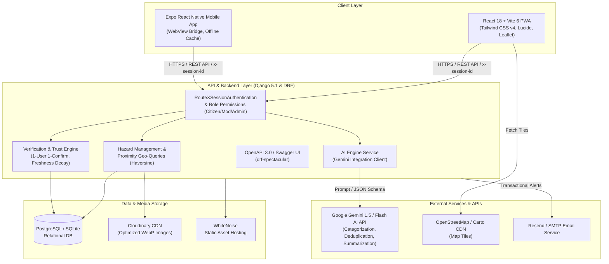

**RouteX** **Product Requirement Document (PRD)**

*Know the Road Ahead.*

| Field | Detail |
| :---- | :---- |
| Document Status | Complete / Approved for Hackathon Submission |
| Product Name | RouteX |
| Team Name | NextGen |
| Lead Author | Ibitokun Morounfoluwa David (Lead), Bamgbose Akinlade, Haleem Akintayo (Team NextGen) |
| Date | October 2026 |
| Version | 1.0.0-MVP |
| Scope | DevFest Abeokuta 2026 Buildathon |

 

# **1\. Executive Summary**

Every day across Abeokuta and Nigerian urban corridors, millions of motorists, commercial riders (Okada/Keke), cyclists, and pedestrians navigate critical road infrastructure fraught with sudden potholes, washed-out gullies, flash flooding, fallen electric poles, and unannounced construction bottlenecks. Existing proprietary navigation apps (Google Maps, Apple Maps) focus primarily on vehicle traffic speeds and arterial routes; they fail to provide granular, ground-level hazard awareness, civic road condition transparency, or local verification.

**RouteX** is a community-powered, AI-assisted road hazard reporting and civic awareness platform. Built by team **NextGen**, RouteX empowers everyday citizens to capture, verify, and track road hazards in real time, while giving municipal moderators and emergency authorities actionable, structured intelligence. Integrated with **Google Gemini AI**, RouteX intelligently categorizes hazards, polishes citizen descriptions, alerts users to nearby duplicate reports, and synthesizes critical incident summaries for safety moderators.

# **2\. Problem Statement & Opportunities**

## **2.1 The Problem**

1. **Pervasive Unreported Hazards:** Deteriorated road sections, severe potholes, and sudden debris cause vehicular damage, accidents, and life-threatening delays without advance warning.  
2. **Delayed Municipal Awareness:** Local road maintenance agencies (e.g., OGRUMED, FERMA) lack real-time civic feedback loops to pinpoint high-risk corridors before disasters escalate.  
3. **No Ground-Truth Verification:** Existing social media complaints (e.g., on X/Twitter) are fragmented, lack geocoding, go unverified, and quickly get buried.  
4. **Bandwidth & Device Barriers:** Many citizens rely on low-bandwidth mobile connections and lack space to download large native applications.

## **2.2 The Solution**

RouteX delivers:

* **Instant Geospatial Visualization:** An interactive, lightweight OpenStreetMap/Leaflet live map showing real-time, color-coded road hazards in Abeokuta with custom 10km "Near Me" radius filtering.  
* **Low-Friction Reporting with Client Optimization:** Rapid hazard submission with client-side EXIF scrubbing, WebP image compression, and GPS coordinate capture  
* **AI-Powered Intelligence:** Google Gemini AI analyzes reporter text to suggest hazard categories, optimize incident descriptions, detect duplicates, and generate moderator briefings.  
* **Democratic Verification Engine:** A "1-Citizen 1-Confirmation" protocol that elevates community-verified hazards while aging out stale reports based on configurable freshness windows.  
* **Role-Based Civic Dashboards:** Three dedicated dashboards (Citizen Commuter, Moderator Safety Queue, Platform Administrator) ensuring transparent governance and content integrity without exposing backend administrative tools.  
* **PWA & Mobile Native Experience:** Fully installable as an offline-capable Progressive Web App and accompanied by an Expo React Native mobile shell.

# **3\. Product Goals & Success Metrics**

## **3.1 Primary Goals**

* ## **Empower Civic Participation:** Allow any commuter to report a road obstruction in under 45 seconds.

* ## **Enhance Road Safety:** Provide clear advance warning of hazardous road conditions to reduce vehicle repair costs and accidents.

* **Ensure Trust & Accuracy:** Implement crowd confirmation thresholds and mandatory moderator audit trails to eliminate false alarms and spam.  
* **Seamless Accessibility:** Ensure smooth operation across 3G/4G networks, mobile browsers, and desktop screens.

## **3.2 Success Metrics (KPIs)**

| Metric | MVP Target | Method of Measurement |
| :---- | :---- | :---- |
| Report Submission Time | \< 45 seconds | Time from tapping "Report" to API success |
| Verification Accuracy | \> 85% | Percentage of community-confirmed reports validated by moderators |
| Duplicate Prevention | \> 40% reduction | AI duplicate prompt interceptions converted to 1-click confirmations |
| Test Suite Coverage | 100% core endpoints | 68 Django unit/integration tests \+ 15 mobile tests passing |

 

# **4\. User Personas & User Journeys**

## **4.1 Persona 1: "Tunde the Daily Commuter" (Registered Citizen)**

* **Profile:** 28, rides a motorcycle/car daily between Panseke and Adatan in Abeokuta.  
* **Needs:** Needs to know if there's flash flooding or deep craters on his commute before hitting the road.  
  **Journey:** Opens RouteX on mobile, clicks "Near Me" (10km filter), spots a hazard reported 20 minutes ago at Ibara Roundabout, takes an alternate route, and upvotes/confirms the report when he passes by.

## **4.2 Persona 2: "Mrs. Adebayo the Civic Moderator" (Safety Moderator)**

* **Profile:** 35, community safety coordinator collaborating with local traffic agencies.  
* **Needs:** Efficiently reviews crowd-reported incidents, dismisses spam/fake flags, and updates resolved road repairs.  
  **Journey:** Logs into /moderator, filters high-priority flagged hazards, inspects attached photographic evidence, reviews the Gemini AI incident summary, and marks the report as "Confirmed" with an official audit log.

## **4.3 Persona 3: "Chidi the Platform Admin" (System Administrator)**

* **Profile:** Platform architect monitoring operational health and policy parameters.  
* **Needs:** Controls community thresholds, oversees system audit logs, and assigns moderator roles.  
  **Journey:** Accesses /admin-dashboard, adjusts the community auto-confirm threshold from 3 to 5 during peak rainy seasons, audits user role promotions, and reviews live platform metrics.

# **5\. System Features & Functional Specifications**

## **5.1 Interactive Live Map Engine & Technical Architecture**

Across both web and mobile, RouteX uses Leaflet with OpenStreetMap (OSM) to power interactive geospatial visualizations.

### **1\. Web App (frontend)**

* **Map Library / Engine:** Leaflet 1.9.4 with react-leaflet (v4.2.1).  
* **Primary Tile Provider:** OpenStreetMap (OSM) (https\://tile.openstreetmap.de/{z}/{x}/{y}.png).  
* **Secondary / Switchable Layer:** Esri World Street Map (https\://server.arcgisonline.com/...), toggleable via the OSM / Esri Streets buttons at the top-right of the map.  
* **Key Components:**  
  * **HazardMap.jsx** — Live interactive map with color-coded hazard markers, clustering, and 10km proximity circles.  
  * **LocationPickerMap.jsx** — Interactive pin-drop map for submitting hazard reports.

### **2\. Mobile App (mobile — Expo / React Native)**

* **Map Library / Engine:** Leaflet 1.9.4 hosted inside a native react-native-webview bridge.  
* **Tile Provider:** OpenStreetMap (OSM) (https\://tile.openstreetmap.de/{z}/{x}/{y}.png).  
* **Key Components:**  
  * **NativeMapScreen.tsx** — Native map screen supporting touch gestures, custom pin popups, and toggle between map and card views.  
  * **LocationPickerMapNative.tsx** — Tap-to-drop coordinate picker on the mobile report screen.

### **Why This Stack?**

5. **Zero Billing / Quota Limits:** OpenStreetMap is free and open-source, eliminating expensive Google Maps Platform API billing quotas and credit card requirements.  
   **100% Visual Parity:** Because both platforms use Leaflet \+ OSM, the marker pins, category colors, and map styling look and behave identically across browsers and mobile devices.

## **5.2 Hazard Reporting & AI Enhancement (/report)**

* **Map Pinpicker & GPS Auto-Detect:** Automatically queries browser geolocation with full fallback to manual interactive pin-drop.  
* **Client-Side Image Compression:** Converts uploaded camera images to WebP format, compresses under 5MB, and scrubs personal EXIF/GPS metadata before upload.  
* **Gemini AI Category Suggestion:** Analyzes natural language input (e.g., "huge ditch filled with rainwater near gate") and predicts the standard category (Pothole / Flood).  
* **Gemini AI Description Enhancer:** Polishes brief or unclear submissions into concise, actionable safety advisories.  
  **Proactive AI Duplicate Detection:** Queries nearby hazards within 300 meters; if a similar report exists, prompts the user: "Did you mean \[Hazard Title\]? Confirm with 1 click instead of re-submitting\!"

## **5.3 Community Verification & Trust Engine**

* **1-User 1-Confirmation:** Enforced at database level via unique compound constraint (hazard\_id, user\_id).  
* **Auto-Confirmation Threshold:** When a hazard reaches N confirmations (configurable, default: 3), status transitions automatically from reported to confirmed.  
* **Freshness Window & Decay:** Hazards unconfirmed after H hours (configurable, default: 48h) receive a "Stale / May No Longer Reflect Ground Conditions" badge.  
  **Citizen Flagging:** Commuters can flag reports as Inaccurate, Spam, Resolved, or Inappropriate with optional notes.

## **5.4 Dedicated Role-Based Dashboards**

### **1\. Citizen Dashboard (/dashboard and /my-reports)**

* Personal statistics: Total Submissions, Confirmations Received, Active Alerts, Cleared Hazards.  
  History list with status filters, freshness indicators, and 1-click edit/withdrawal controls.

### **2\. Moderator Review Queue (/moderator)**

* Live queue of flagged reports sorted by severity.  
* Evidence inspector with high-resolution photographic proof modal.  
* Quick action panel: Confirm, Mark Under Review, Mark Resolved, Dismiss Flag (requires mandatory reason text).  
  Complete historical moderation log.

### **3\. Platform Administrator Portal (/admin-dashboard)**

* Custom frontend interface (100% decoupled from Django's built-in /admin/).  
* Role management: Search users, promote/demote (Citizen ↔ Moderator ↔ Admin) with self-demotion lockout prevention.  
* Live operational parameters tuning: Auto-confirm threshold, Freshness decay hours, Maximum file upload size.  
  Platform-wide audit trail with searchable event logs.

## **5.5 Progressive Web App (PWA) & Mobile Shell**

* **PWA Manifest:** Standalone display mode, high-res maskable SVG branding, and theme colors (\#142B3B and \#087F8C).  
* **Service Worker (sw.js):** Offline app shell caching, network-first API requests, and fallback offline banner.  
  **Expo React Native App:** Native mobile wrapper featuring custom Android hardware back-button interceptor, offline banners, and camera integration.

# **6\. Technical Architecture & Technology Stack**

The system is organized into four layers. Client applications communicate with a Django REST backend over HTTPS using the x-session-id header alongside standard session cookies. The backend persists data in PostgreSQL or SQLite, stores media on Cloudinary, and calls external services for AI processing, map tiles, and email.

| Layer | Components | Responsibility |
| :---- | :---- | :---- |
| Client Layer | React 18 \+ Vite 6 PWA (Tailwind CSS v4, Lucide, Leaflet); Expo React Native mobile app (WebView bridge, offline cache) | User interface, geolocation, camera capture, offline support |
| API & Backend (Django 5.1 & DRF) | RouteXSessionAuthentication and role permissions (Citizen / Moderator / Admin); Hazard management and Haversine proximity queries; Verification and trust engine; AI engine service (Gemini client); OpenAPI 3.0 / Swagger UI via drf-spectacular | Business logic, access control, geo-queries, verification rules, API documentation |
| Data & Media Storage | PostgreSQL (production) / SQLite (development); Cloudinary CDN for optimized WebP images; WhiteNoise for static assets | Persistent records, media delivery, static hosting |
| External Services | Google Gemini 3.5 Flash Lite (categorization, deduplication, summarization); OpenStreetMap / Carto tiles; SMTP email | AI intelligence, map rendering, transactional alerts |

 

*Figure 1: RouteX System Architecture Diagram outlining Client, API/Backend, Storage, and External Service layers.*

## **6.1 System Requirements**

### **Minimum Client System Requirements**

**Web / Progressive Web App (PWA)**

* Browser compatibility: modern evergreen browsers (Chrome 90+, Safari 14+, Firefox 90+, Edge 90+, Samsung Internet 15+).  
* Device memory: minimum 2 GB RAM (4 GB recommended).  
* Network: functional on 3G (minimum 250 kbps); optimized for 4G/5G/Wi-Fi.  
  Hardware features: foreground GPS / geolocation sensor support, camera and file upload access.

**Mobile Native Application**

* Android: Android 8.0 (Oreo / API Level 26\) or higher, 2 GB RAM, approximately 45 MB free disk storage.  
  iOS (Expo shell): iOS 14.0 or higher, approximately 50 MB free disk storage.

### **Minimum Server & Runtime Requirements**

* **Backend host:** minimum 1 vCPU and 512 MB RAM (1 GB+ recommended for Gunicorn concurrent workers).  
* **Runtime:** Python 3.11 to 3.13.  
* **Application server:** Gunicorn 26+ behind Nginx or a cloud PaaS (Heroku, Render, or Railway).  
* **Database:** PostgreSQL 14+ (production) or SQLite 3.35+ (local development and testing).  
* **Storage:** ephemeral root container storage plus a Cloudinary persistent media bucket.  
  **Frontend hosting:** Vercel, Netlify, or Cloudflare Pages static edge CDN, built with Node.js 18.x to 22.x and npm, pnpm, or yarn.

### **External Integration Prerequisites**

* **Google Gemini API:** valid Google AI Studio API key with access to Google Gemini 3.5 Flash Lite  
* **Cloudinary account:** cloud name, API key, and API secret for WebP hazard media uploads.  
  **Tile server:** unrestricted network access to Carto (basemaps.cartocdn.com) and OpenStreetMap tile endpoints.

# **7\. Security, Privacy & Civic Ethics**

* **Zero-PII AI Boundary:** Google Gemini receives only raw hazard titles and descriptions; no user emails, usernames, IP addresses, or location histories are sent to the AI model.  
* **Client-Side EXIF Scrubbing:** All camera and GPS metadata embedded in user photos are stripped before upload to protect reporter privacy.  
* **No Background Geolocation:** RouteX queries foreground GPS only on demand, when the user clicks "Near Me" or "Locate Me".  
* **Resilient Session & CSRF Architecture:** Custom RouteXSessionAuthentication supports secure cross-origin requests (Vercel frontend ↔ Heroku backend) via x-session-id headers alongside standard browser cookies.  
  **Right to Erasure:** Self-service account deletion preserves hazard reports with anonymized ownership (models.SET\_NULL) to maintain civic safety archives.

# **8\. Rollout Plan & Hackathon Milestones**

| Phase | Status | Scope |
| :---- | :---- | :---- |
| Phase 1 | Complete | Core web MVP, Leaflet map, DRF APIs, database seeders with Abeokuta hazard dataset, 68/68 backend tests passing |
| Phase 2 | Complete | Google Gemini AI integration: smart categorization, description enhancer, duplicate detector, incident summarizer |
| Phase 3 | Complete | Citizen, Moderator, and Administrator portals; PWA offline support; Expo React Native mobile shell with 15/15 tests passing |

 
